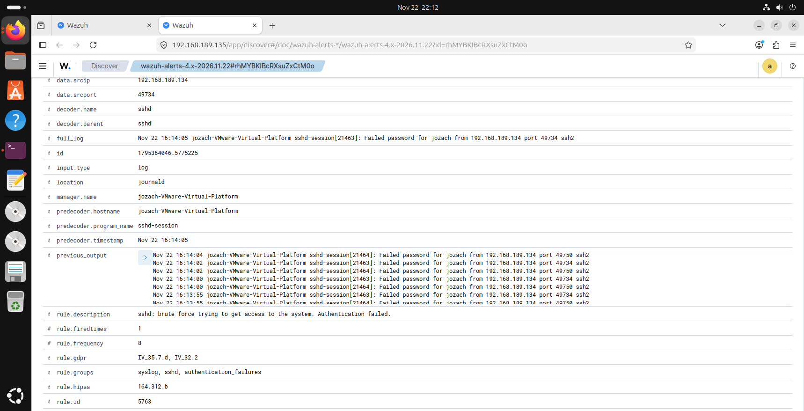

# Wazuh SIEM Home Lab: Detection, Custom Rules and Active Response

A hands-on SOC lab built on **VMware Workstation (Windows 11 host, 8 GB RAM)**. A single **Ubuntu 26.04 LTS** VM runs the full Wazuh stack and doubles as the monitored SSH target, while a **Kali Linux** VM plays the attacker. The lab covers the whole detection loop: collect, decode, detect, validate, respond.

> **Status:** replace the placeholder results below with your own screenshots and alert values before publishing.

## Why this lab was rebuilt

The first version used the Wazuh server OVA (4 GB) plus a separate Ubuntu endpoint and Kali on the same 8 GB laptop. The Wazuh indexer never reached the `active (running)` state, so the dashboard could not load and no alerts could be stored. The rebuild:

- installs Wazuh on a plain **Ubuntu Server 26.04 LTS** VM with the official installation assistant instead of the OVA
- merges the "server" and the "endpoint" into one VM, so the lab needs only two VMs
- keeps Kali small (text mode, 1 GB) and powers it on only for the attack tests
- adds swap and verifies the indexer heap so the stack stays inside the host's RAM budget

## Architecture

```
Windows 11 host (VMware Workstation, VMnet8 NAT)
 |
 |-- Ubuntu 26.04 LTS  (4 GB RAM, 2 vCPU)   Wazuh indexer + manager + dashboard
 |                                           OpenSSH server (attack target)
 |                                           custom log, FIM directory, iptables
 |
 '-- Kali Linux        (1 GB RAM, 1 vCPU)   Hydra attacker, powered on only for tests

Attack:   Kali --SSH brute force--> Ubuntu :22
Detect:   journald / custom log --> manager (decoders + rules) --> indexer --> dashboard
Respond:  manager --> firewall-drop Active Response --> iptables DROP for the attacker IP
```

## What the lab demonstrates

| Area | What was done |
|------|----------------|
| Deployment | Wazuh all-in-one on Ubuntu 26.04 LTS via the installation assistant |
| Detection | Hydra SSH dictionary attack from Kali, escalated by built-in rules into a brute-force alert |
| Custom logic | Custom log source, two-stage decoder, single-failure rule (100100) and threshold rule (100101), tested in `wazuh-logtest` |
| Response | `firewall-drop` Active Response blocks the attacker IP for 180 seconds |
| Monitoring | Real-time File Integrity Monitoring on `/opt/sensitive_data` (added, modified, deleted) |
| Mapping | MITRE ATT&CK **T1110 Brute Force** |

## Hardware and software

| Item | Value |
|------|-------|
| Host | Windows 11 laptop, 8 GB RAM |
| Hypervisor | VMware Workstation Pro |
| Server VM | Ubuntu Server 26.04 LTS, 4 GB RAM, 2 vCPU, 60 GB thin disk |
| Attacker VM | Kali Linux, 1 GB RAM, 1 vCPU, 25 GB thin disk |
| SIEM | Wazuh 4.14.x (installation assistant, all-in-one) |
| Attack tool | Hydra |
| Network | VMware NAT (VMnet8), isolated from the home LAN |

> Wazuh's own quickstart recommends 8 GiB RAM for an all-in-one server. A 4 GB VM is a tight, lab-only setup: one monitored host, short retention, Kali powered off until needed.

## Quick start

1. Create the Ubuntu 26.04 Server VM (OpenSSH server enabled) and the Kali VM on VMnet8.
2. On Ubuntu, with Kali powered **off**:
   ```bash
   sudo fallocate -l 4G /swapfile && sudo chmod 600 /swapfile && sudo mkswap /swapfile && sudo swapon /swapfile
   curl -sO https://packages.wazuh.com/4.14/wazuh-install.sh
   sudo bash ./wazuh-install.sh -a
   ```
   Copy the admin password and back up `wazuh-install-files.tar`. Do not re-run `-a` on a working host.
3. Check health: `scripts/health_check.sh`, then open `https://<UBUNTU_IP>` from the Windows host.
4. Apply the configs in [`configs/`](configs) and run the attack and event scripts in [`scripts/`](scripts).
5. Full procedure with checkpoints: see the report in [`docs/`](docs).

## Repository layout

```
configs/    decoder, rules, localfile, active-response and FIM snippets
scripts/    hydra_attack.sh, gen_custom_log_events.sh, health_check.sh
docs/       lab report and screenshots/
```

## Results

Add your screenshots to `docs/screenshots/` using these names:

| Task | Screenshot |
|------|------------|
| Dashboard with server healthy | `dashboard_overview.png` |
| Hydra attack from Kali | `hydra_attack_terminal.png` |
| SSH brute-force alert | `ssh_bruteforce_alert.png` |
| wazuh-logtest output | `logtest_output.png` |
| Custom rule alerts 100100 / 100101 | `custom_rule_alert.png` |
| Active Response block | `active_response_block.png` |
| FIM events | `fim_events.png` |

Example embed once the files exist:

```markdown

```

## Detection summary

| Detection | Rule ID | Level | MITRE |
|-----------|---------|-------|-------|
| SSH brute force (valid user) | 5763 (confirm from your alert) | 10 | T1110 |
| Custom: single failed login | 100100 | 5 | |
| Custom: repeated failures from one source | 100101 | 10 | T1110 |
| FIM: file added / modified / deleted | 554 / 550 / 553 | 5-7 | |

## Lessons learned

- A SIEM stack is sized by its indexer. Check RAM, swap and the indexer heap **before** debugging anything else.
- A detection is finished only when it is written, tested in `wazuh-logtest`, triggered live and, where sensible, tied to a response.
- Threshold rules separate a mistyped password from a brute-force pattern.
- Active Response needs the right rule ID and a working firewall backend (`iptables`).

## Safety

Everything runs on an isolated NAT network against machines I own. Do not point Hydra or any attack tooling at systems you do not own or have written permission to test. Never commit `wazuh-install-files.tar`, passwords or certificates (see `.gitignore`).

## References

- Wazuh documentation: quickstart and installation assistant (documentation.wazuh.com)
- "Setup Your Own FREE SIEM at Home! - Wazuh", Joshua Clarke (YouTube, April 2025)
- MITRE ATT&CK T1110, Brute Force

## Author

**Jozach Rajan Samual**, B.Tech Cybersecurity, aspiring SOC Analyst
[LinkedIn](https://linkedin.com/in/jozach-samual/) | [GitHub](https://github.com/JozachSamual25)
